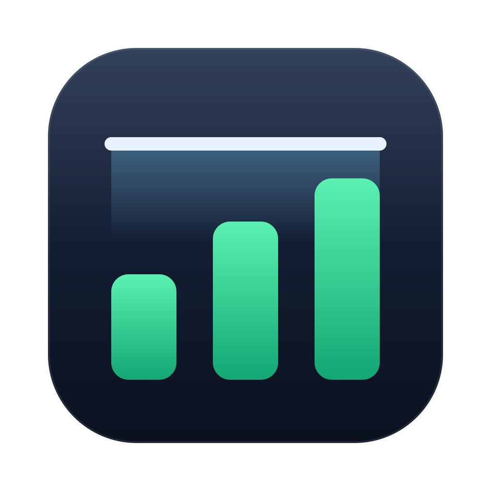

<p align="center"></p>

# Headroom

A small macOS menu bar app that keeps a developer's Mac fast: it shows what's filling the disk and using memory, cleans rebuildable dev caches safely, and measures how much you can run at once (simulators, emulators, dev servers, agent sessions).

[](https://github.com/medaimane/headroom/actions/workflows/ci.yml)

Native SwiftUI, no dependencies, no network, no telemetry. It uses about 20 MB of memory.

**Website and guide:** [medaimane.github.io/headroom](https://medaimane.github.io/headroom/) (source in [`docs/`](docs/)).

## What v1 does

| Area | What you get |
|---|---|
| **Menu bar** | Free disk, memory pressure, swap, CPU and thermal state at a glance, with the top memory users. The icon turns into a warning when something needs attention. |
| **Health** | Live charts for the last hour, plus memory and CPU grouped by what's running: iOS Simulator, Android emulator, Claude Code agents (one row per worktree), Metro, Next.js, Nx/builds/tests, Gradle, Xcode, Docker/VMs, browsers, and more. |
| **Storage** | Free space against a target (100 GB by default), and the size of every known developer cache: DerivedData, DeviceSupport, Gradle, npm, Yarn, pnpm, CocoaPods, Metro, Playwright, Homebrew, … |
| **Safe clean-up** | Pick caches, review exactly what goes and how it rebuilds, then confirm. Dry run is on until you turn it off. |
| **Simulators & devices** | Simulator runtimes and devices, Android AVDs and system images, and Xcode archives, with size and last use. Each item is removed only after its own confirmation. |
| **Explore disk** | A read-only, size-sorted drill-down of your home folder. |
| **Worktrees** | Every git worktree under `~/Developer`: branch, uncommitted changes, unpushed commits, last commit, node_modules and Nx cache size. Read-only. |
| **Workload snapshots** | Record a named workload (for example "1 sim + 1 emu + Metro + Next + 2 agents") and keep its peaks: memory, pressure, swap growth, CPU, thermal state. |
| **History** | Every action, when it ran, its size and how to undo it. Exportable as Markdown. |
| **Warnings** | Notifications for low disk, sustained memory pressure, heavy swap and throttling (debounced). |

## Safety rules (enforced in code and covered by tests)

- **Nothing is deleted without your click**, and nothing is deleted automatically.
- **Only allow-listed caches are cleaned** ([`StorageCatalog.swift`](Sources/HeadroomCore/Storage/StorageCatalog.swift)). Each item is checked by [`PathGuard`](Sources/HeadroomCore/Cleanup/PathGuard.swift) when the plan is made and again right before removal:
  - it must be strictly inside an allow-listed folder (no `..`, no symlinked cache folder pointing elsewhere);
  - it must not be inside a git working tree;
  - it must not be or contain a `.env*.local` file;
  - symlinks are removed as links, never followed.
- **A cache is skipped while its tool runs** (for example DerivedData while `xcodebuild` runs, and Metro's cache while Metro runs).
- **Anything that isn't a cache needs its own confirmation per item:** simulator runtimes and devices go through `xcrun simctl`, and AVDs, system images and archives go to the Trash so you can put them back. Docker images and volumes are shown only.
- **Repositories are read-only.** Git runs with `--no-optional-locks` and never fetches, commits or changes branches.
- **Logs, env files and configs are never opened.** Logs are shown by size only. Process command lines are used only to recognize Metro, Next.js and so on, and are never stored or shown.
- **No network calls, no telemetry, no sudo.**
- **Debug builds can't delete anything on your Mac:** they force dry run unless pointed at a fixture home in a temporary folder (`HEADROOM_HOME`).

Clean-up notes: Xcode's DerivedData contains Swift package checkouts managed by Xcode. They're part of the cache and are rebuilt with it.

## Download

Get `Headroom.zip` from the [latest release](https://github.com/medaimane/headroom/releases/latest) (Apple silicon and Intel, macOS 14+). Unzip it and move Headroom to Applications.

The app is signed but not notarized yet (that needs a paid Apple Developer account), so macOS blocks the first launch: click **Done**, then **System Settings ▸ Privacy & Security ▸ Open Anyway**. Details are in the [guide](https://medaimane.github.io/headroom/guide/#first-launch).

## Build and run

Requirements: macOS 14+, Xcode 16+ (Swift 6). No other tools.

```bash
make app          # build/Headroom.app, release, ad-hoc signed
open build/Headroom.app
make install      # optional: copy to ~/Applications
make release      # universal build/Headroom.zip + .sha256 for a GitHub release
make test         # unit tests
make cli ARGS=storage   # read-only reports: health, processes, storage, devices, worktrees, plan
make icon         # re-render Resources/AppIcon.icns from docs/assets/icon.svg
make site         # serve the website locally at http://localhost:8765
```

Builds are signed ad hoc ("Sign to Run Locally"). A build you make yourself opens without a Gatekeeper prompt; downloaded builds need the one-time approval above until the app is notarized with a Developer ID.

### Permissions

- **Full Disk Access** is optional. Without it, a few protected folders (the Trash, other apps' data) show partial sizes, marked with a lock. Developer caches don't need it.
- **Notifications** are requested the first time a warning fires.
- **Open at login** is off until you turn it on in Settings.
- The app isn't sandboxed: it has to read `~/Library/Developer`, inspect processes and run `xcrun simctl` and `git`. The hardened runtime is on.

Data lives in `~/Library/Application Support/Headroom` (`settings.json`, `history.jsonl`, `snapshots.json`).

## Layout

```
Sources/HeadroomCore   logic, no UI: metrics, process grouping, storage catalog, guard, planner, executors, git, records
Sources/Headroom       SwiftUI app: menu bar, window, settings
Sources/headroom-cli   read-only command-line reports
Tests/HeadroomCoreTests  Swift Testing; clean-ups run only against fixture folders in $TMPDIR
docs/                  website (GitHub Pages): landing page, guide and assets
scripts/               app bundle and icon build scripts
```

## Roadmap

1. Capacity estimate from your snapshots, and a warning before starting one device too many.
2. Dev environment panel: running simulators, emulators and servers, what's on ports 8081, 3000 and others, and a graceful stop with confirmation.
3. Docker, Colima and OrbStack resource limits and a backend profile.
4. Login items, launch agents and daemons explained.
5. Apps and tools inventory (Homebrew, App Store, version managers, duplicates).
6. Scheduled weekly checks.
7. Device and build tuning (AVD RAM and cores, Gradle JVM, Metro and watchman) with backups.
8. node_modules clean-up for merged, clean, pushed worktrees.

## Contributing

Bug reports, cache locations and fixes are welcome. Start with [CONTRIBUTING.md](CONTRIBUTING.md): setup, the safety rules every change must keep, and how to send a pull request. Please follow the [code of conduct](CODE_OF_CONDUCT.md), and report security or safety problems privately as described in [SECURITY.md](SECURITY.md).

## Changelog

See [CHANGELOG.md](CHANGELOG.md). Release steps are in the [guide](https://medaimane.github.io/headroom/guide/#releasing).

## License

MIT, see [LICENSE](LICENSE).
